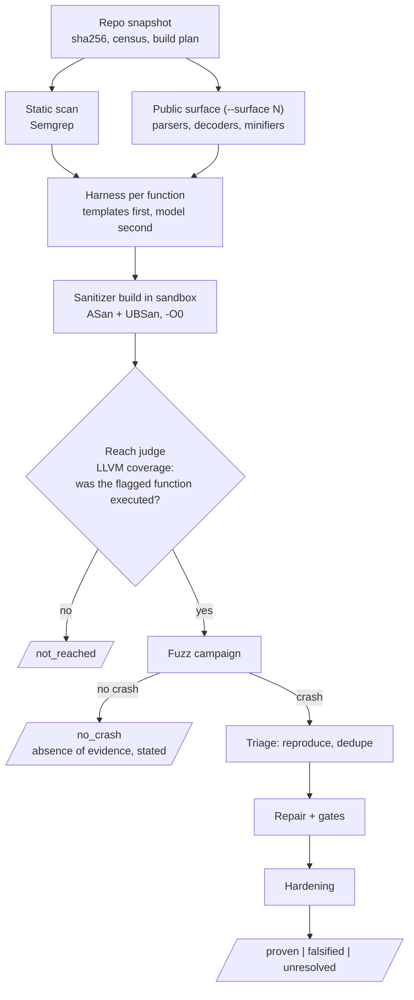
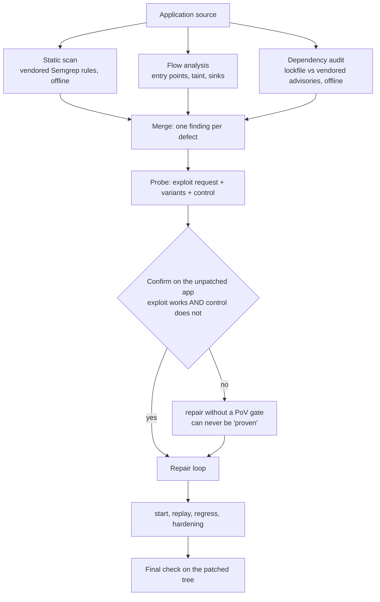

# AI Kavach CRS: Architecture

**What it is:** an autonomous Cyber Reasoning System. It finds a vulnerability in an application it has
not seen, proves the vulnerability with a replayable exploit, patches it with a language model, and then
tries to prove its own patch wrong before reporting it.
**Languages:** C/C++ (sanitizers and fuzzing) and JavaScript/Node web apps (flow analysis and HTTP exploits).
**Updated:** October 2026. **Results and method:** [`benchmark.md`](benchmark.md) (C benchmark).
**Where we stand, and what is unproven:** [`STATUS.md`](STATUS.md). **Plan:** [`NODEGOAT_PLAN.md`](NODEGOAT_PLAN.md).

> **How to read the claims.** Numbers come from runs on a MacBook Air M3 (16 GB) unless stated.
> Sections marked *carried over* describe components that were not changed or re-tested in the latest work.
> Section 11 lists what is not proven.

---

## 1. The idea

A language model proposes patches; **the model is never trusted**. A patch is accepted only if:

1. the application still builds or starts,
2. a **replayable exploit** that worked on the original no longer works (the proof of vulnerability),
3. the application's normal behaviour is preserved (the regression gate), and
4. the patch survives an attack of its own: other spellings of the exploit, re-fuzzing, differential
   comparison against the original.

The design bet is that verification, not model strength, carries correctness, so a small local model is
enough. A weaker model shows up as a lower pass rate, not as unsafe patches getting through.

Every gate is tri-state: `pass`, `fail` or `skipped`. **A gate that did not run is never counted as a
pass**, and a result that rests on a skipped proof-of-vulnerability gate can never be reported `proven`.

---

## 2. One core, two language backends

Every language needs the same five jobs: find a candidate, prove it with an exploit, patch it, verify the
patch, attack the patch. The model only does the third. What differs per language is how the other four are
done. The core is shared; the backends are not forced into one mould.

| Job | Shared core | C/C++ backend | JavaScript/Node backend |
|---|---|---|---|
| Find | findings with a status and a written reason | Semgrep, fuzzing the public parsers (`--surface`) | vendored Semgrep rules + generic taint-flow analysis + offline dependency audit |
| Prove | exploit replayed against the rebuilt/restarted app | sanitizer crash from the fuzzer | HTTP exploit with a checkable oracle |
| Patch | agents alpha, beta, gamma, critic delta; adaptive or ensemble strategy | unified diff or whole function | the flagged function, spliced by syntax-tree range |
| Verify | tri-state gates, patch policy, hang timeouts | build under ASan/UBSan, behaviour oracle | start, replay, regression flows (a runner) |
| Attack the patch | falsify, retry once with the reason | re-fuzz, differential, CBMC (carried over) | replay exploit variants (alternate encodings) |

Also shared: the sandbox, the audit trace and endpoint pinning (section 8), the event stream, the dashboard,
the reproducibility bundle, and the rules about honesty (skipped is never a pass; a failed audit is an
error, never an empty "clean" result).

---

## 3. Shared repair core

### 3.1 Agents

| Agent | Role |
|---|---|
| **Alpha** | Analyst: reasons about the root cause, then patches |
| **Beta** | Minimalist: the smallest bounds or validation check |
| **Gamma** | Standard remediation for the vulnerability class |
| **Delta** | Critic: reads a failed gate's output and returns one structured instruction; never writes code |

### 3.2 Strategy

**`adaptive`** (default for autonomous work) spends model calls in proportion to how hard the bug is:
alpha first (up to 3 tries); if it fails, beta (3 tries, told what alpha tried and the verbatim rejection);
only if both failed, gamma on a stronger model (up to 5 tries, told everything). The stronger model is
probed per API key and never assumed. **`ensemble`** (default in the C benchmark, so its published numbers
keep their meaning) runs alpha, beta and gamma in parallel and keeps the smallest validated patch.

Measured on OpenAI, same targets and flags (C benchmark): both strategies 13 of 13; model calls
76 to 20 (about 74% fewer) and cost 55 to 70% lower with adaptive. The price: patches grow (mean 3.6 to 4.9
and 2.3 to 4.3 lines), because the ensemble used to pick the smallest of three. Single runs, small n.

### 3.3 Gates

| Gate | Check |
|---|---|
| Apply | the patch applies (a diff, or a function replacement spliced by syntax-tree range) |
| Policy | single file; no test or build edits; only the flagged function; size cap; no added code or shell execution, outbound calls, swallowed errors, time conditions, listeners, emptied function (the C and JS policies differ in detail, not in intent) |
| Build / start | compiles under sanitizers (C), or the patched application starts healthy (JS) |
| Proof of vulnerability | the exploit no longer works; a hung binary is killed (SIGKILL; `alarm` is swallowed by libFuzzer) and reported as a hang |
| Regression | behaviour preserved: a behaviour oracle recorded from the original (C), or the application's own flows (JS) |
| Hardening | see 3.4 |

A deterministic controller (not a model) decides when to call the critic, force the whole-function format,
or stop early after repeated identical attempts.

### 3.4 Hardening: trying to falsify a patch

Passing the gates shows one input stopped working; it does not show the fix is right.

- **Variants** (JS): other spellings of the exploit (a protocol-relative redirect, an alternate encoding of a
  traversal, a different arithmetic form) are replayed. A patch that blocks one spelling and leaks another is
  overfitted and is rejected with the leaking variant named to the model, inside the repair loop. Only
  variants that **work on the unpatched application** are used; a variant that never worked would "pass"
  any patch and prove nothing.
- **Re-fuzz and differential** (C): the patched build is re-fuzzed in fork mode and compared against the
  original on the corpus and on mutated neighbours of the crashing input. A crash the original also has is
  reported as a separate pre-existing bug, not blamed on the patch.
- **Retry:** a falsified patch goes back to the model once with the real reason; the first failure is kept in
  `previous_attempts`, so a retry is never shown as a first-try success.
- *Carried over:* behavioural contracts (`preserve`, `restrict`, `replace`), the evasion battery for
  `restrict` fixes, and bounded model checking (CBMC) on three synthetic targets. `survived` requires that a
  check actually compared something.

---

## 4. C/C++ backend (autonomous mode)

Design points, each from a failure we hit: harnesses are derived from the code (preconditions mined from
real callers), not guessed; a model-drafted harness is repaired from the compiler's or the sanitizer's
output and gets a NUL-terminated copy of the input (models routinely over-read the raw bytes); a harness
that never reaches the flagged function proves nothing; `-O0` so inlining cannot move a crash into the
harness; the PoV gate replays every crash in the cluster plus same-line variants.

*Carried over:* libFuzzer and AFL++ adapters, crash triage and deduplication, Tree-sitter C context
extraction, Driller (self-gated; disables itself where the solver fails its known-answer test).

---

## 5. JavaScript/Node backend

### 5.1 Finding candidates

- **Vendored Semgrep rules** (233 from the public registry plus 7 generic Node rules), shipped as files:
  nothing is fetched at run time.
- **Generic flow analysis** (`src/jsauto/flow.py`). It knows no application; it works from structure.
  1. *Entry points by role.* A function is an entry point if it is registered on a route
     (`x.get("/p", h)`, `route({path, handler})`) or reads an HTTP-looking property off one of its own
     parameters. The parameter is the request whatever it is called, and whichever framework (Express, Koa,
     Fastify, Hapi shapes are handled).
  2. *Taint slice.* User data is followed through variables, destructuring, templates, concatenation and
     calls, **across files** (a route handing a value to a data layer is analysed through to the query it
     builds). Sanitisers (`parseInt`, `encodeURIComponent`, validators) stop the flow.
  3. *Provenance.* Each tainted variable remembers which request fields fed it, so a sink whose argument is
     just a variable still says which fields to send. The entry also records every field the handler reads.
  4. *Sinks from data.* A call receiving tainted data is classified by the module it was imported from
     (`require`/`import`), its function name and the shape of the call, against `config/js_knowledge.json`.
  5. *Unknown calls are not guessed at and not dropped.* They go to a classifier (the model), the answer is
     cached, and calls left unclassified are reported as such. A failing model is reported, never silent.
  Results are candidates; a probe confirms them.
- **Offline dependency audit.** The registry is not allowed, so a vendored snapshot of public advisories
  (400 KB, 7,216 advisories, built before the event from the OSV dump with malware reports excluded) is
  matched against the lockfile's dependency graph. A vulnerable sub-dependency is attributed to the direct
  package that brings it in. On NodeGoat it returns the same 10 packages and severities as `npm audit`.
  A missing lockfile or snapshot is an error, never an empty result.
- Credentials in test, seed or local-development files are reported as `informational`, not as defects. A
  committed private key is never downgraded.

### 5.2 Probes: describing an exploit without sending it

From a finding, `probes.py` builds a request in the contract both sides share
(`{method, path, body, login_as, success_if}`; SSRF adds `oob` with `{OOB_URL}` / `{OOB_MARKER}`
placeholders that the runner fills in with a loopback listener). Rules that came from the first live run:

- **Send every field the handler reads**, benign except the one carrying the payload; a handler that reads
  three fields and gets one fails its own validation, which looks exactly like "not vulnerable".
- Use arithmetic on a marker where possible (`7*3` must produce a standalone `21`), so reflecting the input
  cannot fake a hit; keep the marker small because applications validate numeric input.
- **Control request:** the same request with a benign value. If the oracle also matches it, the oracle
  fires without any attack and the exploit is not trusted (`control_matched` in the evidence).
- Classes with no usable oracle (SQL and NoSQL injection, ReDoS, deserialization) are listed with the reason
  and are repaired without a PoV gate, so they can never be `proven`.

### 5.3 Repair

The model is shown one function between markers, the class's generic fix guidance, the route, and the call
chain the data travelled. Its answer replaces that function by **syntax-tree range**, must parse, and must
pass the patch policy (section 3.3). Dependency fixes are deterministic: raise the version to the published
fix, never a major bump (left for a human), never a new dependency, and the result is `patched_unproven`
because the installed packages were not re-resolved. A private key in the repository is reported as not
fixable by a code edit (it must be removed and rotated).

### 5.4 The `fix` command

    python -m src.jsauto.fix --target DIR --runner some.runner.module [--classes ...] [--attempts 3]

Per finding: confirm the exploit on the unpatched app, keep the variants that work there, repair, harden.
Accepted patches accumulate on a copy, so a later fix is made against earlier ones and a finding already
fixed by an earlier patch is reported as `already_fixed`. At the end the final tree is started, the
regression flows are run, and every confirmed exploit is replayed. Output: `evidence.json` (a status and a
written reason per finding, with the exploit and control used), `patches/<id>.diff`, `final.diff`.

### 5.5 The runner (the harness side)

The application's start, replay and regress commands come from a separate runner given on the command line
(`KAVACH_RUNNER_MODULE`); the engine has no default and never reads the runner's answer key. The NodeGoat
runner starts the app on its own port with its own database, **loopback only** (a preload forces every
listener onto 127.0.0.1, from outside the target tree so a patch cannot disable it), throttled, and tears it
down. It owns the manifest (the scoring answer key), the exploit PoVs and variants, and the regression flows.

---

## 6. Genericity: nothing may know the target

The final application may be a customised version of the one we developed against, so:

- Rules recognise a request by **role**, not by the name `req`; ecosystem knowledge (dangerous APIs,
  request shapes, fix guidance, probe payloads) is **data** in `config/*.json`, extended from what the
  model classifies and a probe confirms, never hand-edited per application.
- **Rename-mutation tests** rewrite every parameter, file and function name of an application and require
  identical detection. They found a real bug (SSRF was lost when `req` was renamed).
- **A name tripwire** fails the build if engine code, rules or the dashboard mention the benchmark
  application. It caught a hard-coded runner module name.
- **A held-out application** (DVNA, never tuned for) is scanned as is. Without a model, 5 of 6 core
  injection classes were found by some detector and 3 of 6 by the flow analysis; **with the local model
  classifying the unknown calls, 6 of 6** (6 model calls, 84 s; one run).

---

## 7. Sandbox

`KAVACH_SANDBOX=off|auto|required`. Autonomous mode defaults to `required`: with no backend the command is
**not run**, and the result says why. macOS uses `sandbox-exec` (network denied, writes confined to the
workspace); Linux uses `bwrap`. The network-denial test has a positive control: the same probe connects
unsandboxed and is refused inside. We state what the sandbox denies and show the test; we do not claim
"air-gapped". Measured overhead on one C benchmark target: 49 to 58 s under `required` against 36 to 37 s off
(n = 2, includes cloud latency). Comments in target source that match prompt-injection patterns are replaced
by a same-length marker before any prompt is built.

---

## 8. Audit trail and endpoint control

Both are enforced at one choke point every model call goes through, not trusted to each caller.

- **Audit trace** (`KAVACH_LLM_TRACE`): one JSON line per call (prompt, response, model, endpoint without
  credentials, tokens, seconds, and the error if it failed). Nothing is sampled.
- **Pinning** (`KAVACH_ALLOWED_ENDPOINTS`, `KAVACH_ALLOWED_MODELS`): a call to an undeclared endpoint or model is
  refused before any request is made and is not retried. The stronger model for adaptive escalation is chosen
  only from declared models, and only if the API key can actually call it.

---

## 9. Model backend

The client speaks the OpenAI chat-completions protocol, so any compatible endpoint works by setting
`OPENAI_BASE_URL` (Ollama, vLLM, llama.cpp, a gateway).

- **Local model: `gemma4:12b` (Ollama).** It reports a "thinking" capability, and thinking must be off for
  patch work: with it on, one short request spent all 800 tokens reasoning, took 118 s and returned an empty
  answer; off, 9.3 s. The client asks the model server whether a model can think (never decides from a name)
  and turns it off. Never sent to the official OpenAI endpoint.
- **Cloud baseline:** OpenAI `gpt-4o-mini` for the C benchmark.
- Quality as a *repairer* on real handlers is not yet measured for the local model; its quality as a
  *classifier* of unknown calls is (section 6). The first live run used a much smaller `gemma4:e2b` over the
  LAN and failed to repair one finding, while the gates correctly rejected every bad attempt.

---

## 10. Platform

FastAPI dashboard (drag-and-drop a repository or zip, start analysis, run the benchmark, live event stream;
localhost only, a non-localhost bind requires a token), JSONL event stream, a reproducibility bundle per run
(manifest of file hashes, tool versions, `reproduce.sh`, which fails unless the re-run produced a new run
directory), the verifier red-team (11 deliberate cheat classes, all caught; the execution gates alone catch
none of them, the policy and hardening layers do), and the four-tier memory (working, episodic, semantic,
procedural; carried over, on only with `--memory`).

---

## 11. Measured results, and what is not proven

**C benchmark.** Last full sweep (2026-08-30, 44 targets, `gpt-4o-mini`): 44/44 passed all gates (95% CI
92.0 to 100.0), 30/30 proof-of-vulnerability, hardening 32 attacked and 0 falsified, $0.0739; that sweep has
**not** been re-run on the current code. Autonomous mode on cJSON v1.7.10 found CVE-2019-11835 in
`cJSON_Minify` with no hand-written proof; the patch was proven in 4 of 5 adaptive runs (the miss was a model
availability bug, since fixed), about 133 to 160 s and $0.002 to 0.013 per run.

**NodeGoat (first JS target).** Static detection against the 12-entry answer key: recall 9 of 12; the three
misses (IDOR, XSS, CSRF) need live probes. The runner, 12 regression flows and exploit PoVs work on a
live app. First live run of the whole cycle: the open-redirect finding was `unresolved` (gates caught a
patch that leaked a variant, a malformed answer, and a still-exploitable attempt; the model was too weak);
the eval finding got a correct model fix but was reported `patched_unproven` because my probe did not
confirm the bug. Both probe bugs (marker too large, handler fields not all sent) and a third (SSRF produced
no probe) were found and fixed afterwards; those fixes have unit tests but **have not yet been re-run live
by the full cycle**.

**Not proven, stated plainly:**

- Everything on the JS side beyond detection rests on one application and one live run.
- "`proven`" means the patch survived the proof-of-vulnerability, regression and variant checks (JS), or a
  137-input differential and a short re-fuzz (C). It is not a formal proof of correctness.
- A fuzzer or probe finding nothing is absence of evidence, never a safety claim.
- No probe oracle exists for SQL/NoSQL injection, ReDoS or deserialization; those can only be repaired
  without a PoV gate.
- The dependency snapshot is as old as its build date and knows only packages with a published advisory.
- Two detector gaps are marked `xfail` in the tests: aliased destructured imports and chained
  `router.route()` registration.
- Adaptive versus ensemble rests on single runs. The held-out DVNA result is one run.

**Tests:** about 420 unit tests. None needs a model server; the macOS sandbox tests need `sandbox-exec`, and one
needs the network for its positive control. The last full run was 396 passed with 2 expected failures; tests
added since were run file by file, not as a full suite.
