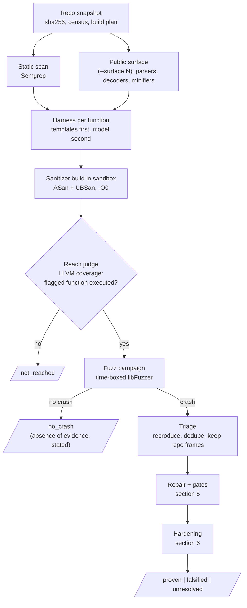

# AI Kavach CRS — Architecture

**What it is:** an autonomous Cyber Reasoning System for C/C++. It finds a memory-safety
bug, patches it, and then tries to prove its own patch wrong before reporting it.
**Updated:** October 2026 (pre-finale build). **Results and method:** [`benchmark.md`](benchmark.md).
**Plan and status log:** [`FINALE_PLAN.md`](FINALE_PLAN.md).

> **How to read the claims in this document.** Every number is from a run on a MacBook
> Air M3 (16 GB). Sections marked *carried over* describe components that were not
> changed or re-tested in the pre-finale work; they are reproduced from the earlier
> document. Section 10 lists what is not proven.

---

## 1. The idea in one paragraph

A language model proposes patches; **the model is never trusted**. Every patch must pass
physical checks (it compiles under sanitizers, the exploit no longer crashes the rebuilt
binary, normal behaviour is preserved), and is then attacked (re-fuzzed, compared against
the original, bounded-model-checked where a proof harness exists). The design bet is that
verification, not model strength, carries correctness, so a small cheap model is enough.

---

## 2. Two ways in

| | **Benchmark / scan path** | **Autonomous path** (new) |
|---|---|---|
| Input | A curated target: known bug, hand-written PoV and regression command | Any C repository, nothing declared in advance |
| Entry | `python benchmark.py ...`, `python -m src.main --target X` | `python -m src.main --mode auto ...`, or drag-and-drop in the dashboard |
| Where the bug comes from | Semgrep finding or fuzz harness we wrote | Semgrep **and** public-parser fuzzing (`--surface`) |
| PoV | Hand-written, pre-flighted on the unpatched build | The fuzzer's own crashing input |
| Regression gate | A command we wrote | A behaviour oracle recorded from the original binary |
| Repair strategy | Ensemble (default) or adaptive | Adaptive (default) or ensemble |

Both paths share the same repair loop, gates and hardening.

---

## 3. Autonomous path (new)

Every finding ends in `evidence.json` with a **status and a written reason**; nothing is
dropped silently. Statuses: `not_reached`, `no_crash`, `build_failed`, `crash_confirmed`,
`proven`, `patched_unhardened`, `falsified`, `unresolved`, `unproven`.

Design points, each from a failure we hit:

- **Harnesses are derived from the code, not guessed.** The index (Tree-sitter) mines
  preconditions from real callers (literal argument sets, minimum buffer sizes,
  `sizeof` relations). Templates cover byte-buffer+length, C string, integers and
  caller-sized output buffers; the model drafts the rest.
- **Model-drafted harnesses are repaired, not trusted.** A compile error or a crash that
  occurs *before* the target runs is fed back to the model (up to 3 attempts, recorded).
  Models routinely pass the fuzzer's un-terminated bytes to string APIs, which makes the
  harness itself over-read, so a wrapper hands a drafted harness a NUL-terminated copy.
- **A harness that never reaches the flagged function proves nothing.** The reach judge
  builds with LLVM source coverage and requires that function to have executed
  (`-print_coverage` is empty on macOS, so it is not used).
- **`-O0`** so inlining cannot move a crash into the harness; **dSYM** so crash frames
  keep file:line.
- **`--surface N`** fuzzes public input-parsing functions that no static rule flagged.
  Semgrep flagged cJSON's *print* code; the real CVE-2019-11835 is in `cJSON_Minify`.
- Everything that executes uploaded code runs through the sandbox (section 7).

---

## 4. Detection, triage and context (*carried over, plus autonomous additions above*)

- **Static:** Semgrep (`p/security-audit`), SARIF.
- **Dynamic:** libFuzzer (Homebrew LLVM, since Apple clang ships no fuzzer runtime) and
  AFL++ with an adapter; ASan/UBSan with `-fno-sanitize-recover=all`.
- **Triage:** replays crashes, normalises stacks (drops interceptors, libc, fuzzer
  frames), clusters by root cause, maps crash class to CWE. CASR if present, else a native
  parser.
- **Context:** Tree-sitter extracts the enclosing function plus the structs, unions,
  enums and typedef chains it uses, so the model sees real types.
- **Concolic (Driller / angr):** self-gated. A known-answer self-test runs first, and if
  the solver cannot recover it on this platform it disables itself with a logged reason.

---

## 5. Repair and verification

### 5.1 Agents

| Agent | Role |
|---|---|
| **Alpha** | Analyst: reasons about root cause, then patches |
| **Beta** | Minimalist: smallest bounds/null check |
| **Gamma** | Standard CWE remediation |
| **Delta** | Critic: reads a failed gate's output and returns one structured instruction. Never writes code. |

Patches arrive as a unified diff or as a whole-function replacement spliced by AST range
(forced after two apply failures).

### 5.2 Strategy (new)

**`adaptive`** (default in autonomous mode) spends model calls in proportion to how hard
the bug is:

1. **Alpha**, up to 3 tries. An easy bug costs one agent run and nothing else.
2. **Beta**, up to 3 tries, told what alpha tried and the verbatim rejection.
3. **Gamma on a stronger model**, up to 5 tries, told everything that failed.

The stronger model is **probed per API key and never assumed** (this key can call
`gpt-4.1-mini` only; an assumed `gpt-4o` crashed a tier once). Elsewhere it is unset and
nothing claims it. Agents keep their names; the model used is recorded separately.

**`ensemble`** (default in the benchmark, so published numbers keep their meaning) runs
alpha, beta and gamma in parallel and picks the smallest validated patch.

Measured on OpenAI, same targets, same flags:

| | Passed | Model calls | Cost |
|---|---|---|---|
| Synthetic 10, ensemble | 10/10 | 43 | $0.0101 |
| Synthetic 10, adaptive | 10/10 | 11 | $0.0043 |
| Real CVE 3, ensemble | 3/3 | 33 | $0.0222 |
| Real CVE 3, adaptive | 3/3 | 9 | $0.0068 |

About 74% fewer calls, 55–70% lower cost. The price: patches grow (mean 3.6 → 4.9 and
2.3 → 4.3 lines) because the ensemble used to pick the smallest of three. Single runs,
small n; no significance claimed.

### 5.3 Gates

A patch is accepted only if every configured gate passes. **A gate with no command is
`SKIPPED` and is never counted as a pass.**

| # | Gate | Check |
|---|---|---|
| 0 | Apply | Diff or function replacement applies to a pristine copy |
| 1 | **Policy** (new) | Single file; no test or build-file edits; change inside the flagged function; at most 80 changed lines; no added `signal`/`sigaction`, `no_sanitize`/`optnone` attributes, inline asm, `exit`, `getenv`, `setjmp`/`longjmp` |
| 2 | Build | Compiles under ASan + UBSan |
| 3 | PoV | The exploit no longer crashes the rebuilt patched binary. **In autonomous mode this replays every crash in the cluster plus near-variants that crash the original at the same line.** A hung binary is SIGKILLed after 10 s and reported as a hang. |
| 4 | Regression | Benign behaviour preserved. Autonomous mode uses an oracle recorded from the original binary (exit code and stdout hash on every input it handled cleanly). |
| 5 | Post-scan | Semgrep finds nothing new. **Skipped for uploaded repos**, and reported as skipped. |

A deterministic controller (not a model) decides when to call the critic, force the
whole-function format, or stop early after four consecutive identical attempts.

---

## 6. Hardening: trying to falsify a patch

Passing the gates shows one input stopped crashing; it does not show the fix is right.

1. **Re-fuzz** the patched build (fork mode, so one crash does not end the campaign).
   A crash on an input where the *original is clean* falsifies the patch (overfitting, or a
   leak that accumulates into an out-of-memory). A crash the original also has is a
   **separate pre-existing bug**: it is listed in the evidence and not blamed on the patch.
2. **Differential test** against the original on the corpus, seeds and mutated
   neighbours of the crashing input. Skipped when re-fuzz has already falsified the patch.
3. **Behavioural contracts** (*carried over*): `preserve` (memory-safety fixes must not
   change behaviour), `restrict` (input-validation fixes must reject what the original
   accepted), `replace` (a changed compiled-in value must change output).
4. **Evasion battery** (*carried over*): replays bypass encodings against `restrict` fixes.
5. **Retry** (new): a falsified patch goes back to the model **once** with the real reason
   (`--hardening-retries`, default 1). The first failure is kept in `previous_attempts`, so
   a retry is never shown as a first-try success, and both attempts' cost is counted.

`HardeningVerdict.survived` requires that a check **actually compared something**; a check
that tested zero inputs is not credited.

**Bounded model checking (CBMC)** (*carried over*): proves the patched function safe over
all inputs within an unwind bound, never "correct". Three proofs exist, all on synthetic
targets. A CBMC spike on a real function (cJSON `parse_string`) has not been done.

---

## 7. Sandbox and prompt-injection defence (new)

`KAVACH_SANDBOX=off | auto | required`. Autonomous mode defaults to `required`: if no
backend exists the command is **not run**, and the result says why.

- **macOS:** `sandbox-exec` with the network denied and writes confined to the run
  workspace (TMPDIR moved inside it). **Linux:** `bwrap`.
- The network-denial test has a positive control: the same probe connects unsandboxed and
  is refused inside. We state what the sandbox denies and show the test; we do not claim
  "air-gapped".
- **Measured overhead:** one benchmark target took 49–58 s under `required` against
  36–37 s off (n = 2; includes cloud model latency).
- **Injection scrub:** comments in target source that match injection patterns are
  replaced by a same-length marker before the prompt is built; code and strings are
  untouched, and the event is logged.

---

## 8. Platform

- **Dashboard** (FastAPI, `python -m dashboard`, localhost only; a non-localhost bind
  requires a token): drag-and-drop a repository or zip, start auto mode (fuzz seconds,
  repair on/off), run the benchmark or special cases, watch a live event stream. It shows
  provider, tool availability and, for local models, the model server's memory (read from
  Ollama `/api/ps`, because Apple-silicon GPU memory is not in the process RSS).
- **Event stream:** JSONL events from the benchmark and autonomous runner, streamed by SSE.
- **Reproducibility bundle:** every run directory gets `manifest.json` (sha256 of every
  file; hash-manifested, not signed), `tool-versions.json` and `reproduce.sh`.
  `reproduce.sh` fails (exit 3) unless the re-run produced a new run directory.
- **Verifier red-team:** 11 deliberate cheat classes plus the honest fix, each run
  through policy, gates and hardening. **11 of 11 caught, honest fix passes every layer.**
  The execution gates alone catch none of them; the policy and hardening layers do.
- **Memory** (*carried over*): working (attempt ledger), episodic (JSONL), semantic
  (only gate- and hardening-validated fixes, with confidence decay), procedural (agent
  success per CWE; on only with `--memory`).

---

## 9. Model backend

The client speaks the OpenAI chat-completions protocol, so any compatible endpoint works
by setting `OPENAI_BASE_URL` (Ollama, vLLM, llama.cpp, a gateway). Nothing else names a
provider.

| Backend | Result | Note |
|---|---|---|
| OpenAI `gpt-4o-mini` | Synthetic 10/10 (7/7 PoV-proven); real CVE 2/3 and 3/3 across runs | Published baseline |
| On-device `gemma4:12b` (Ollama) | Not yet benchmarked | Thinking must be off: one short request took 118 s with an empty answer when on, 9.3 s when off. Speed, memory and pass rate are unmeasured |

A weaker model shows up as a lower pass rate, not as unsafe patches getting through, but
the rate must be re-measured per deployment.

---

## 10. Measured results and what is not proven

**Last full sweep (2026-08-30, 44 targets, `gpt-4o-mini`, before the pre-finale changes):**
44/44 passed all gates (95% CI 92.0–100.0), 30/30 PoV-proven, hardening 32 attacked, 0
falsified, 5 with no applicable check; $0.0739 total. That sweep has **not** been re-run
on the current code. Since the changes, only the synthetic 10 and the 3 real CVEs were
re-run (table in 5.2 and section 9).

**Autonomous mode, cJSON v1.7.10, no hand-written PoV or root cause:** `--surface`
found the real overflow in `cJSON_Minify` (CVE-2019-11835); the patch was `proven` in 4
of 5 adaptive runs (the miss was the model-availability bug above, since fixed), at about
133–160 s and $0.002–0.013 per run. Of that time only about 13 s is analysis; the rest is
model calls and the hardening re-fuzz.

**Not proven, stated plainly:**

- Autonomous mode has been shown on **one real library (cJSON)** and one demo repo. No
  held-out library yet.
- "`proven`" means the patch survived a 137-input differential and a 15–20 s re-fuzz. It
  is **not** a formal proof of correctness.
- Fuzzing finding nothing (`no_crash`) is absence of evidence, never a safety claim.
- The post-scan gate is skipped for uploaded repositories.
- Real-CVE CVE-2019-11834 (`parse_string`) is unstable: it failed in some runs.
- Adaptive vs ensemble rests on single runs; the 55–70% saving is a measurement, not a
  guarantee.
- zlib CVE-2022-37434, a CBMC proof on a real function, and the four pre-registered
  held-out libraries are **not done**.

**Tests:** 253 unit tests passed at the last full run; none needs an API call.
